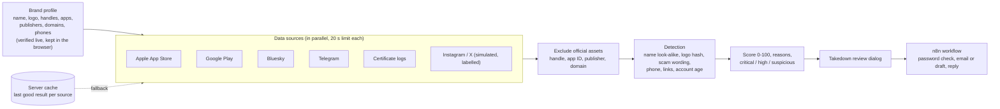

# CloneX

Brand impersonation monitoring for app stores and social platforms. Kampus.VC hackathon, Challenge 3: *Digital Risk Protection, Social & App Monitoring*.

**Live demo:** https://clonex-app.vercel.app · **Video walkthrough:** https://clonex-app.vercel.app/demo/CloneX-demo.mp4 (takedown runs in demo mode there: notices go only to the owner's test inbox, never to a platform)

You describe your real brand once. CloneX searches for look-alike apps and accounts, explains each detection in plain language with a 0 to 100 score, never flags your own official assets, and lets an analyst send a reviewed takedown notice through an n8n workflow.

## Round 2: from a list of suspects to an investigation queue

HacXLerate Round 2 asks for a scoring and investigation layer analysts can trust. What was added on top of the Round 1 detector:

| Round 2 requirement | How CloneX does it |
|---|---|
| Record per detection: source, suspected asset, evidence, score, status | Each card shows the platform and handle, **which official asset it imitates** (taken from the brand profile, or "none listed" when the profile has none), the reasons, the 0 to 100 score and a status |
| Evidence-based, graded, explained score | The evidence drawer lists every signal with its points (name, logo, scam wording, phone, age) and a plain-language reason for each |
| Official assets never flagged | They are removed before scoring and listed under "Excluded assets" |
| Review, confirm or dismiss | Statuses: New, Under review, Confirmed, False positive, Closed. Only sensible moves are allowed, and the server re-checks each one |
| Highest risk first | The default **Open queue** is sorted by score. False positives and closed cases drop out and can be shown with the status filters |
| History of changes and who made them | Every decision is an append-only row with the analyst's name and a timestamp, shown in the evidence drawer |
| Bonus: takedown report draft | Available only for a **Confirmed** case: an editable, evidence-only notice with an authorisation tick-box, Copy and Download |
| Bonus: high-risk alerts, not repeated | One in-app banner per new critical or high detection; a re-scan stays quiet for detections already alerted |

**Case history is shared.** When the Supabase variables are set (see Settings), decisions go to one Postgres table, `case_events` (`db/schema.sql`), through `/api/cases`, so every analyst sees the same queue and history, refreshed every 15 seconds. Without them the app still works and keeps the history in the analyst's browser.

**Look-alike domains** are found two ways: the certificate-transparency logs (often down) and a direct DNS check of about 250 typo, scam-word and other-ending variants of the brand's domain. A registered look-alike is evidence, not proof: the domain may belong to an unrelated owner, so the analyst decides.

## Run it

```bash
npm install
npm run dev          # http://localhost:3000
```

For a demo, use the production build with an auto-restarting server:

```bash
npm run demo         # builds, then runs scripts/serve.mjs on port 3000
```

Everything works with no configuration. Optional settings go in `.env.local` (see `env.example`).

## What is live, simulated and cached

| Source | Status |
|---|---|
| Apple App Store (iTunes Search API) | Live |
| Google Play (unofficial scraper) | Live |
| Bluesky (public API) | Live |
| Telegram (public preview pages, with fallback hosts for networks that block `t.me`) | Live |
| Look-alike domains (public DNS check of generated variants, plus certificate-transparency logs) | Live. The certificate logs are often slow or down; the DNS check does not depend on them |
| Instagram, X | **Simulated demo feed, always labelled.** These platforms block automated access. |

Every result carries a LIVE, SIMULATED or CACHED badge. If a source fails, the scan continues, the last good result for that source is shown as CACHED, and the dashboard says which source was unavailable.

## Architecture



**Storage:** the brand profile and last scan stay in the browser. The server keeps a small cache of the last good result per source, so a failing source falls back to a result labelled CACHED. Analyst decisions and their history are stored in Postgres (Supabase) when it is configured, otherwise in the browser. No personal data is collected: a case row holds only the brand, the detection id, the status, the analyst's chosen name and a timestamp.

**Official assets are removed before scoring**, by handle, app ID or package, publisher name and domain, so a brand's own accounts and apps can never be flagged.

## How detection works

1. **Brand profile** (step 1): name, logo, official handles, apps, publishers, domains and support numbers. Search any brand and the form fills itself from the stores. Every asset is verified live.
2. **Official assets are excluded before scoring** (handle, app ID, publisher, domain).
3. **Signals** are combined into one explainable score: name look-alike (character swaps, added words, spacing), logo similarity (perceptual hash), scam wording, unofficial phone number, links to non-official sites, account age. A second signal is required before a name match is flagged, to avoid over-flagging innocent names.
4. **Triage** (step 2): critical (75+), high (55 to 74) and suspicious (below 55), with evidence and the suspect's logo beside the original.
5. **Accuracy** (step 3): the labelled test sets run live against the real detection code. The development set (194 names) scores 100% and is an upper bound. The held-out set (31 names) scores 87% precision, 76% recall and 81% F1; that is the honest number.

## Takedown through n8n

"Initiate Takedown" appears on a **confirmed** critical or high finding and opens a dialog with an editable notice, the target abuse desk and an authorisation checkbox. Dispatch posts to `/api/trigger-takedown`, which forwards to an n8n workflow. Three versions are in the repo: `n8n/clonex-takedown-email.workflow.json` (**the one deployed**: emails the analyst and the brand's security team through Gmail, but only addresses on an approved list inside the workflow), `n8n/clonex-takedown.workflow.json` (the original: webhook, Gmail or draft, Telegram alert, password header) and `n8n/clonex-takedown-lite.workflow.json` (webhook only: logs the request, sends no email). In the dialog the analyst can type their own email and the brand security team's email; the server validates each as a single plain address and n8n emails only those on its approved list, so the public site cannot make Gmail send to a stranger. The interface reports exactly what n8n did, for example "Emailed through n8n to a@x.com (demo mode: nothing went to the platform)" or "Not on the approved list, so not emailed: ...". The deployed webhook has no password check; the approved list is the safeguard.

- The server chooses the recipient, never the browser.
- **Demo mode is the default**: every notice goes to `CLONEX_DEMO_INBOX`, never to a platform. Live mode needs `CLONEX_TAKEDOWN_MODE=live` and refuses simulated items.
- With no webhook configured, dispatch is a dry run and the interface says nothing was sent.
- Verify each platform's abuse contact in `src/lib/takedown.ts` before using live mode.

## Settings (`.env.local`)

| Variable | Purpose |
|---|---|
| `N8N_TAKEDOWN_WEBHOOK_URL` | Production URL of the takedown workflow (falls back to `N8N_WEBHOOK_URL`) |
| `N8N_WEBHOOK_SECRET` | Optional, sent to n8n as header `x-clonex-secret` |
| `CLONEX_TAKEDOWN_MODE` | `demo` (default) or `live` |
| `CLONEX_DEMO_INBOX` | Your own inbox for demo-mode notices |
| `CLONEX_NOTIFY_KEY` | Enables `/api/notify` (scan alerts); callers send it as `x-clonex-key` |
| `APIFY_ENABLED` / `APIFY_TOKEN` | Optional. Set `APIFY_ENABLED=true` and a token to add Apify app-store search (App Store + Google Play) next to the built-in sources. At most 50 results and $0.05 per scan; if Apify fails the scan continues without it. Keep the token server-side only |
| `SUPABASE_URL` | Project URL of the Supabase database that holds the shared case history |
| `SUPABASE_SERVICE_ROLE_KEY` | Server-side secret key for that project. Never expose it to the browser or commit it. Run `db/schema.sql` once in the Supabase SQL editor first |

## Tests

```bash
npm test            # 131 unit tests: look-alike matching, scoring, official-asset exclusion, API guards, case status rules, domain variants, case history
npm run test:coverage
```

The accuracy tests also guard the numbers quoted above, so a detection change that lowers them fails the build. CI runs type-check, lint, tests and the production build on every push.

## Known limits

- Instagram and X are simulated; production would need licensed data.
- Google Play uses an unofficial scraper and can be rate-limited.
- The certificate-log source is often unavailable. The DNS check of generated look-alike domains covers for it, but it only finds domains that are registered and live, and a registered typo domain may belong to an unrelated owner.
- Brands that are everyday words (for example Wise or Slice) still collect some unrelated apps and accounts that happen to use the word.
- Names that mix a typo with an added word are missed.
- We scanned all 96 built-in brands against the live sources: no crashes. That run is how we found and fixed over-flagging on short brand names such as CRED.
- A logo cropped by about 15% can slip below the logo-match threshold.
- The brand profile and last scan live in the browser. Case decisions are stored in Postgres when Supabase is configured, otherwise in the browser.
- **There is no login.** Anyone with the link can record a decision. The analyst name is a label the user types, not a verified identity. The API validates input and is rate limited, but real use would need authentication.
- The deployed demo's n8n workflow only logs takedown requests; it does not email anyone. Takedown mode is `demo`, so nothing ever reaches a platform.
- The "already alerted" memory for high-risk alerts is kept per browser, so a new browser may show the alert banner again once.
- The "Imitates" line names an official asset only if the brand profile lists one of that type; the simulated Instagram and X items show "none listed in the profile".

## Stack

Next.js 16 (App Router), React 19, TypeScript, Tailwind CSS v4. Logo matching uses `sharp`. The Step 1 and landing visuals use GSAP and a WebGL shader.
