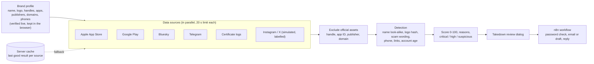

# CloneX

Brand impersonation monitoring for app stores and social platforms. Kampus.VC hackathon, Challenge 3: *Digital Risk Protection, Social & App Monitoring*.

**Live demo:** https://clonex-app.vercel.app · **Video walkthrough:** https://clonex-app.vercel.app/demo/CloneX-demo.mp4 (takedown runs in demo mode there: notices go only to the owner's test inbox, never to a platform)

You describe your real brand once. CloneX searches for look-alike apps and accounts, explains each detection in plain language with a 0 to 100 score, never flags your own official assets, and lets an analyst send a reviewed takedown notice through an n8n workflow.

## Run it

```bash
npm install
npm run dev          # http://localhost:3000
```

For a demo, use the production build with an auto-restarting server:

```bash
npm run demo         # builds, then runs scripts/serve.mjs on port 3000
```

Everything works with no configuration. Optional settings go in `.env.local` (see `env.example`).

## What is live, simulated and cached

| Source | Status |
|---|---|
| Apple App Store (iTunes Search API) | Live |
| Google Play (unofficial scraper) | Live |
| Bluesky (public API) | Live |
| Telegram (public preview pages, with fallback hosts for networks that block `t.me`) | Live |
| Look-alike domains (certificate-transparency logs) | Live, often slow or down |
| Instagram, X | **Simulated demo feed, always labelled.** These platforms block automated access. |

Every result carries a LIVE, SIMULATED or CACHED badge. If a source fails, the scan continues, the last good result for that source is shown as CACHED, and the dashboard says which source was unavailable.

## Architecture



**Storage:** the brand profile and last scan stay in the browser. The server keeps only a small cache of the last good result per source, so a failing source falls back to a result labelled CACHED. Nothing about users is stored.

**Official assets are removed before scoring**, by handle, app ID or package, publisher name and domain, so a brand's own accounts and apps can never be flagged.

## How detection works

1. **Brand profile** (step 1): name, logo, official handles, apps, publishers, domains and support numbers. Search any brand and the form fills itself from the stores. Every asset is verified live.
2. **Official assets are excluded before scoring** (handle, app ID, publisher, domain).
3. **Signals** are combined into one explainable score: name look-alike (character swaps, added words, spacing), logo similarity (perceptual hash), scam wording, unofficial phone number, links to non-official sites, account age. A second signal is required before a name match is flagged, to avoid over-flagging innocent names.
4. **Triage** (step 2): critical (75+), high (55 to 74) and suspicious (below 55), with evidence and the suspect's logo beside the original.
5. **Accuracy** (step 3): the labelled test sets run live against the real detection code. The development set (194 names) scores 100% and is an upper bound. The held-out set (31 names) scores 87% precision, 76% recall and 81% F1; that is the honest number.

## Takedown through n8n

"Initiate Takedown" on a critical or high finding opens a dialog with an editable notice, the target abuse desk and an authorisation checkbox. Dispatch posts to `/api/trigger-takedown`, which forwards to the n8n workflow in `n8n/clonex-takedown.workflow.json` (webhook, email or Gmail draft, team alert).

- The server chooses the recipient, never the browser.
- **Demo mode is the default**: every notice goes to `CLONEX_DEMO_INBOX`, never to a platform. Live mode needs `CLONEX_TAKEDOWN_MODE=live` and refuses simulated items.
- With no webhook configured, dispatch is a dry run and the interface says nothing was sent.
- Verify each platform's abuse contact in `src/lib/takedown.ts` before using live mode.

## Settings (`.env.local`)

| Variable | Purpose |
|---|---|
| `N8N_TAKEDOWN_WEBHOOK_URL` | Production URL of the takedown workflow (falls back to `N8N_WEBHOOK_URL`) |
| `N8N_WEBHOOK_SECRET` | Optional, sent to n8n as header `x-clonex-secret` |
| `CLONEX_TAKEDOWN_MODE` | `demo` (default) or `live` |
| `CLONEX_DEMO_INBOX` | Your own inbox for demo-mode notices |
| `CLONEX_NOTIFY_KEY` | Enables `/api/notify` (scan alerts); callers send it as `x-clonex-key` |

## Tests

```bash
npm test            # 74 unit tests: look-alike matching, scoring, official-asset exclusion, API guards
npm run test:coverage
```

The accuracy tests also guard the numbers quoted above, so a detection change that lowers them fails the build. CI runs type-check, lint, tests and the production build on every push.

## Known limits

- Instagram and X are simulated; production would need licensed data.
- Google Play uses an unofficial scraper and can be rate-limited.
- The certificate-log source is often unavailable.
- Brands that are everyday words (for example Wise or Slice) still collect some unrelated apps and accounts that happen to use the word.
- Names that mix a typo with an added word are missed.
- We scanned all 96 built-in brands against the live sources: no crashes. That run is how we found and fixed over-flagging on short brand names such as CRED.
- A logo cropped by about 15% can slip below the logo-match threshold.
- Nothing is stored server-side besides a small cache of the last good result per source. The brand profile and last scan live in the browser.

## Stack

Next.js 16 (App Router), React 19, TypeScript, Tailwind CSS v4. Logo matching uses `sharp`. The Step 1 and landing visuals use GSAP and a WebGL shader.
